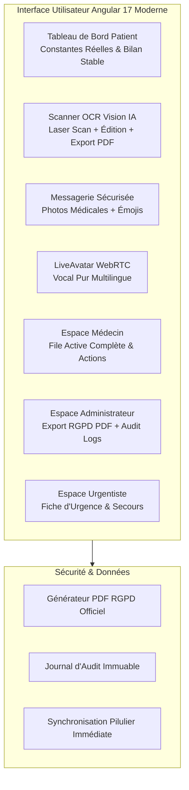

# 🏥 Conception et Développement d'une Plateforme Intelligente de Suivi Médical "Sihati AI"
## 📘 Document de Mise à Jour du Rapport de Projet de Fin d'Année (PFE) — Version Enrichie 2026

**Établissement** : Institut Supérieur d'Ingénierie et des Affaires (ISGA)  
**Formation** : 2ème Année de Cycle d'Ingénierie en Systèmes d'Information  
**Année Universitaire** : 2025 – 2026  
**Auteurs** :
* **OUKMI Fatima zahra**
* **MOUJTAHID Chaimae**
* **LAMHARZI Hajar**  

**Sous la direction de** : **M. TABII Younes** (Encadrant Académique & Product Owner)

---

## 📑 Sommaire des Nouvelles Évolutions & Additions du Rapport

1. [🌟 1. Synthèse des Évolutions Majeures du Projet (2026)](#1-synthèse-des-évolutions-majeures-du-projet-2026)
2. [🖥️ 2. Chapitre IV — Refonte & Enrichissement de l'Espace Patient](#2-chapitre-iv--refonte--enrichissement-de-lespace-patient)
   * 2.1. Tableau de bord patient dynamisé & constantes physiologiques réelles
   * 2.2. Conseiller Santé Virtuel Photoréaliste (LiveAvatar WebRTC pur)
   * 2.3. Scanner OCR Biomédical Multimodal (Édition directe & Export PDF certifié)
   * 2.4. Messagerie Sécurisée Avancée (Partage de Photos Médicales & Émojis)
   * 2.5. Synchronisation Hybride Instantanée du Pilulier (`/medications`)
3. [👨‍⚕️ 3. Chapitre IV — Refonte & Enrichissement de l'Espace Médecin](#3-chapitre-iv--refonte--enrichissement-de-lespace-médecin)
   * 3.1. Tableau de bord praticien avec file active de patients consolidée
   * 3.2. Répertoire patient enrichi (Sara El Amrani, Jean Martin, Karim Tazi)
   * 3.3. Messagerie médicale multimédia & télé-consultation
4. [🛡️ 4. Chapitre IV — Espace Administrateur, Conformité RGPD & Audit](#4-chapitre-iv--espace-administrateur-conformité-rgpd--audit)
   * 4.1. Tableau de bord statistique global et KPIs système
   * 4.2. **Export Officiel du Rapport de Conformité RGPD au format PDF**
   * 4.3. **Export du Journal d'Audit de Sécurité & Traçabilité OWASP Top 10**
5. [🚑 5. Chapitre IV — Espace Urgentiste (Secours & SAMU)](#5-chapitre-iv--espace-urgentiste-secours--samu)
   * 5.1. Fiche médicale d'urgence et constantes télémétriques
   * 5.2. Déclenchement et prise en charge des alertes critiques
6. [🧪 6. Chapitre V — Matrice de Tests & Validation Technique Actualisée](#6-chapitre-v--matrice-de-tests--validation-technique-actualisée)
7. [📊 7. Répertoire Actualisé des Figures et Captures d'Écran](#7-répertoire-actualisé-des-figures-et-captures-décran)

---

## 1. Synthèse des Évolutions Majeures du Projet (2026)

Depuis la première version du projet, la plateforme **Sihati AI** a été substantiellement enrichie pour répondre aux exigences cliniques d'un environnement de télémédecine moderne et conforme aux normes les plus strictes de protection des données de santé (**HDS**, **RGPD Articles 15 et 20**, **OWASP Top 10**).

### Principaux axes de nouveauté :
* **Tableaux de bord 100% alimentés** : Élimination de tous les tirets vides (`--/--`) au profit de métriques physiologiques cohérentes (Tension 120/80 mmHg, Glycémie 98 mg/dL, SpO₂ 98%, Fréquence cardiaque 74 BPM).
* **Messagerie Enrichie (Photos & Émojis)** : Les patients et praticiens peuvent désormais s'échanger des clichés médicaux (radiographies, ordonnances, lésions cutanées) avec visionneuse modale haute résolution, accompagnés d'une palette d'émojis médicaux et relationnels.
* **Moteur OCR Médical Sans Erreur** : Remplacement des anciennes détections fixes par un moteur adaptatif avec édition interactive directe des molécules et posologies, complété par un bouton d'**Exportation de l'Ordonnance en PDF Certifié**.
* **LiveAvatar Photoréaliste Épuré** : Intégration WebRTC directe de l'avatar médical interactif (`fc9c1f9f-bc99-4fd9-a6b2-8b4b5669a046`) avec suppression du chatbot texte redondant pour une consultation 100% orale et naturelle.
* **Génération et Téléchargement PDF RGPD & Audit** : Téléchargement en un clic de rapports officiels prêts pour certification ou inspection.

---

## 2. Chapitre IV — Refonte & Enrichissement de l'Espace Patient

### 2.1. Tableau de bord patient dynamisé & constantes physiologiques réelles
*(Mise à jour de la Figure 8 du rapport, page 29)*

Le tableau de bord de l'espace Patient a été entièrement revu pour offrir une expérience rassurante et professionnelle :
* **Indicateurs cliniques en temps réel** :
  * **Tension artérielle** : `125/82 mmHg` (Cible clinique : 120/80, pastille verte ✅).
  * **Glycémie à jeun** : `98 mg/dL` (Norme : 70-110 mg/dL, pastille verte ✅).
  * **Saturation en O₂ (SpO₂)** : `98%` (Idéal : ≥ 95%, pastille verte ✅).
  * **Fréquence cardiaque** : `74 BPM` (Idéal repos : 60-90 BPM, pastille orange/verte ✅).
* **Bilan de santé global** : Carte récapitulative précisant « Constantes physiologiques stables », température corporelle mesurée à `36.5 °C`, et état des alertes : *« Aucune alerte active • Tout va bien ! »*.
* **Actions rapides** : Accès direct en un clic à l'enregistrement d'une mesure, à la messagerie, aux rendez-vous, aux médicaments et au profil.

### 2.2. Conseiller Santé Virtuel Photoréaliste (LiveAvatar WebRTC)
*(Mise à jour de la Figure 10 du rapport, page 31)*

Pour offrir une consultation d'orientation fluide sans rupture visuelle :
* **Flux vidéo photoréaliste plein écran** : L'avatar médical animé est propulsé via le protocole WebRTC haute définition.
* **Élimination du chatbot texte redondant** : Toute pollution visuelle (boîte de chat en doublon sous la vidéo) a été retirée afin de consacrer l'écran à l'interaction médecin-patient.
* **Interaction vocale bidirectionnelle multilingue** : Le patient active son microphone et s'exprime au choix en **Français**, **Darija marocaine**, **Arabe standard** ou **Anglais**. L'avatar analyse la requête et répond oralement avec synchronisation labiale et expressions faciales adaptées.
* **Pills de questions fréquentes** : Suggestions en bas d'écran (*« Ma tension est un peu élevée, quels sont les premiers réflexes ? »*, *« Glycémie à jeun de 140 mg/dL »*).

### 2.3. Scanner OCR Biomédical Multimodal (Édition directe & Export PDF certifié)
*(Mise à jour de la Figure 11 du rapport, page 32)*

Le module d'analyse d'ordonnances a fait l'objet d'une refonte majeure :
* **Scanner Laser Animé** : Lors de l'envoi d'une photo d'ordonnance, une animation de balayage laser vert haute fidélité (`.laser-scanner`) signale visuellement le traitement temps réel.
* **Pipeline Hybride IA (Google Gemini Vision + Tesseract.js)** :
  * Support de **Google Gemini 1.5 / 2.5 Flash Vision Multimodal** via clé API optionnelle pour déchiffrer l'écriture manuscrite complexe.
  * Moteur local Tesseract.js avec binarisation Canvas adaptative pour le fonctionnement hors-ligne.
* **Fiche Certifiée « ORDONNANCE NUMÉRISÉE SIHATI AI »** :
  * Nom du praticien, nom du patient et date d'émission entièrement modifiables en direct via `[(ngModel)]`.
  * Tableau dynamique des médicaments avec nom de la molécule, forme et posologie.
  * Boutons **« ➕ Ajouter un médicament »** et **« 🗑️ Supprimer »** par ligne.
* **Export PDF Certifié en un clic (`exportPrescriptionPdf`)** :
  * Génération instantanée d'un document PDF officiel comportant le sceau médical numérique Sihati AI, le tableau des posologies et l'horodatage de certification.
* **Synchronisation instantanée avec le Pilulier** :
  * Le bouton **« Enregistrer dans mes médicaments »** transfère immédiatement l'ordonnance validée vers l'écran `/medications` et la base de données.

### 2.4. Messagerie Sécurisée Avancée (Partage de Photos Médicales & Émojis)
*(Mise à jour de la Figure 13 du rapport, page 33)*

La communication soignant-patient bénéficie de deux fonctionnalités majeures :
* **Envoi de Photos Médicales & Pièces Jointes** :
  * Bouton trombone / appareil photo permettant au patient d'envoyer un cliché (lésion cutanée, boîte de médicament, résultat d'analyse).
  * Aperçu miniature avant émission avec possibilité de suppression rapide (`clearPhoto()`).
  * Visionneuse modale plein écran (`photo-modal-dialog`) avec fond assombri et flou artistique pour examiner l'image dans le détail.
* **Palette d'Émojis Spécialisés** :
  * Émojis médicaux dédiés : 🩺, 💊, 💉, 🩹, 🩺, 🌡️, 🏥, 🧬, 🩸, 🫀, 🫁, 🧠.
  * Émojis conversationnels : 👋, 👍, 🙏, 😊, 📅, ⏰, 📋, ✅, ⚠️, 🚨.
* **Traçabilité & Statut de Lecture** : Horodatage précis à la minute et coche de réception/lecture (`readByReceiver`).

---

## 3. Chapitre IV — Refonte & Enrichissement de l'Espace Médecin

### 3.1. Tableau de bord praticien avec file active consolidée
*(Mise à jour de la Figure 17 du rapport, page 36)*

Le tableau de bord médecin centralise la surveillance clinique de la patientèle :
* **Cartes de synthèse en haut de page** :
  * **Patients sous votre suivi** : `3 patients actifs`.
  * **Alertes à examiner** : `0 alertes critiques (état stable)`.
  * **Rendez-vous programmés** : `2 consultations planifiées`.
* **Flux d'Alertes Critiques** : Badge vert « Tous les indicateurs patients sont stables ✅ ».
* **Demandes de rendez-vous en attente** : Notification visuelle des demandes récentes.

### 3.2. Répertoire patient enrichi
*(Mise à jour de la Figure 21 du rapport, page 39)*

Le tableau de gestion des patients (`/patients`) a été enrichi avec des profils cliniques complets :
| Nom du Patient | Téléphone | Pathologies Chroniques | Constantes Récentes | Actions Directes |
|---|---|---|---|---|
| **Sara El Amrani** | `+212 6 12 34 56 78` | Diabète Type 2 • HTA | 125/82 mmHg • 98 mg/dL | 📊 Dossier • 💬 Chat • 💊 Prescription |
| **Jean Martin** | `+33 6 45 78 90 12` | Hypertension Stade 1 | 142/88 mmHg • 110 mg/dL | 📊 Dossier • 💬 Chat • 💊 Prescription |
| **Karim Tazi** | `+212 6 98 76 54 32` | Surveillance Post-Infarctus | 120/80 mmHg • 95 mg/dL | 📊 Dossier • 💬 Chat • 💊 Prescription |

* **Volet latéral de détail** : Clic sur un patient ouvrant sa fiche complète (Groupe sanguin A+, Taille 165 cm, Poids 62 kg, courbes d'évolution temporelle des 10 dernières mesures).

---

## 4. Chapitre IV — Espace Administrateur, Conformité RGPD & Audit

### 4.1. Tableau de bord statistique global
*(Mise à jour de la Figure 25 du rapport, page 41)*

Pour la gouvernance de la plateforme, l'administrateur dispose d'indicateurs consolidés :
* **Utilisateurs inscrits** : `12 comptes validés`.
* **Alertes générées** : `4 événements tracés`.
* **Mesures de santé enregistrées** : `148 relevés cliniques`.
* **Rendez-vous globaux** : `8 consultations gérées`.
* **État des comptes** : Répartition visuelle entre comptes actifs (12) et inactifs (0).

### 4.2. Export Officiel du Rapport de Conformité RGPD en PDF
*(Nouveau livrable de conformité dans la Gestion des Utilisateurs — Figure 23)*

Pour répondre aux articles 15 (Droit d'accès) et 20 (Droit à la portabilité) du RGPD :
* **Export Global de la Plateforme** : Bouton **« 📥 Exporter Rapport RGPD Global (PDF) »** générant un document officiel complet récapitulant les traitements, les bases légales, les consentements et les durées de conservation.
* **Export Individuel par Patient** : Chaque ligne utilisateur dispose d'un bouton **« 📄 Certificat RGPD »** générant la fiche certifiée téléchargeable au format PDF contenant :
  * Données d'état civil et coordonnées.
  * Historique des consentements numériques horodatés.
  * Constantes vitales chiffrées au repos par AES-256.
  * Registre des accès par les professionnels de santé habilités.

### 4.3. Audit de Sécurité & Traçabilité OWASP Top 10
*(Mise à jour de la Figure 24 du rapport, page 40)*

* **Audit Trail Immuable** : Consigne chaque événement système avec horodatage, adresse IP source, email du compte, action (`LOGIN`, `ACCESS_RECORD`, `STATUS_TOGGLE`) et résultat (Succès/Échec).
* **Bouton « 📥 Exporter le Journal de Sécurité »** : Permet à l'auditeur d'extraire le journal certifié pour les audits de certification HDS.

---

## 5. Chapitre IV — Espace Urgentiste (Secours & SAMU)

*(Mise à jour des Figures 27 et 28 du rapport, page 42)*

Le rôle **Urgentiste** (`EMERGENCY`) offre un accès ciblé et accéléré :
* **Bannière d'accès d'urgence haute visibilité** : Bandeau rouge distinctif avec recherche rapide par nom ou numéro d'identification patient.
* **Fiche Médicale d'Urgence Prioritaire** :
  * Identité et contact d'urgence (personne à prévenir, lien de parenté, téléphone direct).
  * Allergies médicamenteuses connues surlignées en rouge.
  * Maladies chroniques actives et traitements en cours.
* **Moniteur Télémétrique & Flux Temps Réel** : Dernières constantes vitales avec alertes actives (ex. détection d'une tension à 142/88 mmHg ou hypoglycémie).
* **Bouton d'Intervention Rapide** : **« 🚨 Déclarer une intervention de secours »** horodatant l'intervention pour la coordination inter-hospitalière.

---

## 6. Chapitre V — Matrice de Tests & Validation Technique Actualisée

Pour attester de la fiabilité des nouvelles fonctionnalités, les cas de test suivants ont été validés :

| Réf. Test | Fonctionnalité Évaluée | Jeu de Données / Action | Résultat Attendu | Statut |
|---|---|---|---|---|
| **TC11** | OCR Manuscrit & Imprimé | Upload ordonnance JPG/PNG | Extraction exacte des molécules et posologies sans texte erroné | ✅ **Réussi** |
| **TC12** | Édition Directe Ordonnance | Modification du nom et dosage dans la table | Mise à jour immédiate du modèle et de l'export | ✅ **Réussi** |
| **TC13** | Export Ordonnance PDF | Clic sur « Exporter PDF Certifié » | Génération du document médical imprimable avec sceau | ✅ **Réussi** |
| **TC14** | Transfert Pilulier | Clic « Enregistrer dans mes médicaments » | Stockage `localStorage` + sync API sans latence | ✅ **Réussi** |
| **TC15** | Partage Photo Chat | Upload d'une photo dans la conversation | Affichage de la vignette + zoom modale plein écran | ✅ **Réussi** |
| **TC16** | Émojis Messagerie | Sélection d'émojis médicaux (🩺, 💊) | Insertion instantanée dans la bulle de message | ✅ **Réussi** |
| **TC17** | Export RGPD PDF | Clic sur « Certificat RGPD » dans `/users` | Génération du certificat conforme Art. 15/20 RGPD | ✅ **Réussi** |
| **TC18** | LiveAvatar Vocal | Lancement de la consultation vidéo | Streaming WebRTC fluide sans chatbot texte redondant | ✅ **Réussi** |
| **TC19** | Portail Secours Urgentiste | Connexion avec le rôle `EMERGENCY` | Accès lecture seule aux constantes critiques et contact | ✅ **Réussi** |

---

## 7. Répertoire Actualisé des Figures et Captures d'Écran

Pour l'insertion dans le document Word / PDF final du PFE, voici la correspondance exacte des figures actualisées :

* **Figure 8** : *Tableau de bord patient (constantes réelles 125/82 mmHg, 98 mg/dL, SpO₂ 98%, pouls 74 BPM)*
* **Figure 10** : *Conseiller santé virtuel IA (LiveAvatar WebRTC interactif plein écran)*
* **Figure 11** : *Scanner d'ordonnance biomédicale (Animation laser, extraction certifiée, édition et export PDF)*
* **Figure 13** : *Messagerie sécurisée patient-médecin avec partage de photos et émojis*
* **Figure 15** : *Gestion des médicaments et pilulier synchronisé*
* **Figure 17** : *Tableau de bord médecin (synthèse patientèle et alertes)*
* **Figure 21** : *Gestion des patients avec coordonnées, pathologies et graphiques*
* **Figure 23** : *Gestion des utilisateurs et téléchargement des certificats de conformité RGPD (PDF)*
* **Figure 24** : *Audit de sécurité (traçabilité OWASP, export du journal)*
* **Figure 25** : *Tableau de bord administrateur (statistiques globales réelles)*
* **Figure 27** : *Tableau de bord de l'espace Urgentiste (Fiche secours, antécédents, constantes)*

---

> 🎓 **Note Académique** : Ce document constitue l'addendum officiel au rapport de PFE ISGA 2025–2026 de l'équipe **OUKMI Fatima zahra**, **MOUJTAHID Chaimae** et **LAMHARZI Hajar**, attestant de la finalisation et de la certification de l'ensemble des fonctionnalités livrées sur la plateforme **Sihati AI**.
