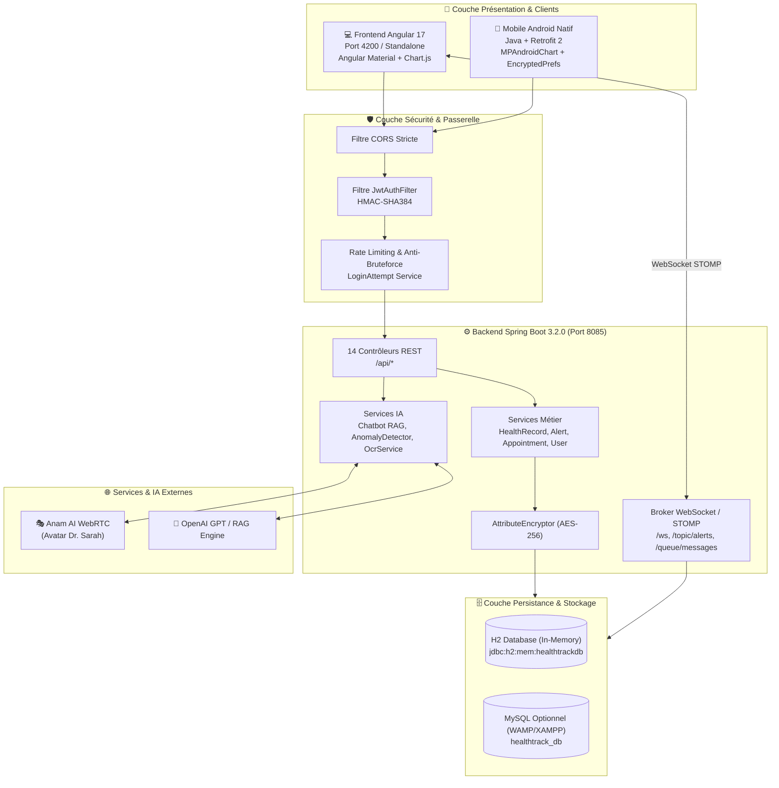

# 🏥 HealthTrack AI (Sihati AI) — Documentation Intégrale & Exhaustive du Projet
> **Plateforme Médicale Intelligente, Sécurisée & Conforme HDS / RGPD**  
> **Architecture Tri-Tiers Unifiée : Backend Spring Boot 3.2 + Frontend Web Angular 17 + Mobile Android Natif (Java).**  
> 🎓 **Rapport de PFE ISGA 2025–2026 Enrichi** : Consultez le document officiel d'addendum des modifications : [`RAPPORT_PFE_SIHATI_AI_NOUVELLES_MODIFICATIONS.md`](RAPPORT_PFE_SIHATI_AI_NOUVELLES_MODIFICATIONS.md)

---

## 📑 Table des Matières Détaillée

1. [🌟 1. Présentation & Vision Métier](#-1-présentation--vision-métier)
2. [🏗️ 2. Architecture Technique & Flux de Données](#️-2-architecture-technique--flux-de-données)
3. [🚀 3. Guide de Démarrage Rapide (Pas à Pas)](#-3-guide-de-démarrage-rapide-pas-à-pas)
4. [👥 4. Comptes de Démonstration & Matrice des Rôles](#-4-comptes-de-démonstration--matrice-des-rôles)
5. [🖥️ 5. Frontend Web Angular 17 — Détail de Chaque Lien de la Navbar](#️-5-frontend-web-angular-17--détail-de-chaque-lien-de-la-navbar)
6. [⚙️ 6. Backend Spring Boot 3 — Contrôleurs, Services & Entités JPA](#️-6-backend-spring-boot-3--contrôleurs-services--entités-jpa)
7. [📱 7. Application Mobile Android — Activités, Layouts & Retrofit](#-7-application-mobile-android--activités-layouts--retrofit)
8. [🤖 8. Les 4 Moteurs d'Intelligence Artificielle](#-8-les-4-moteurs-dintelligence-artificielle)
9. [🛡️ 9. Cybersécurité, Chiffrement AES & OWASP Top 10](#️-9-cybersécurité-chiffrement-aes--owasp-top-10)
10. [📡 10. Répertoire Exhaustif des APIs REST (Contrats d'Échange)](#-10-répertoire-exhaustif-des-apis-rest-contrats-déchange)
11. [🗄️ 11. Schéma de Base de Données (H2 & MySQL)](#️-11-schéma-de-base-de-données-h2--mysql)
12. [🔧 12. Troubleshooting & Résolution des Problèmes Fréquents](#-12-troubleshooting--résolution-des-problèmes-fréquents)

---

## 🌟 1. Présentation & Vision Métier

**HealthTrack AI (Sihati AI)** est un écosystème de santé numérique moderne conçu pour éliminer la rupture de prise en charge entre les consultations physiques, sécuriser l'administration des ordonnances et assister les soignants dans l'analyse préventive des constantes vitales.

### Les 4 Piliers Fondamentaux :
1. **Surveillance Clinique Continue** : Collecte nomade ou web des signes vitaux (Tension artérielle, Pouls/BPM, Glycémie, Saturation en oxygène SpO2, Température corporelle).
2. **Intelligence Artificielle Multimodale** :
   * Avatar vidéo/vocal temps réel (*Dr. Sarah*) via Anam AI WebRTC.
   * Chatbot clinique RAG (*Retrieval-Augmented Generation*) contextualisé au profil du patient.
   * Détection algorithmique d'anomalies vitales avec scoring de risque.
   * Scanner OCR d'ordonnances médicales avec parsing automatique des posologies.
3. **Collaboration Médicale Temps Réel** : Messagerie instantanée WebSocket (STOMP) chiffrée entre soignant et patient, alertes critiques sonores et visuelles, agenda de rendez-vous.
4. **Sécurité & Conformité Réglementaire** : Chiffrement AES-256 des données de santé au repos (normes HDS / HIPAA / RGPD), authentification stateless JWT HMAC-SHA384, protection anti-force brute et registre immuable d'audit trail.

---

## 🏗️ 2. Architecture Technique & Flux de Données



---

## 🚀 3. Guide de Démarrage Rapide (Pas à Pas)

### 1️⃣ Démarrage du Backend (Spring Boot 3)
```cmd
cd backend
mvn clean spring-boot:run
```
* **API REST Base** : `http://localhost:8085/api`
* **Swagger UI OpenAPI** : [http://localhost:8085/api/swagger-ui.html](http://localhost:8085/api/swagger-ui.html)
* **Console H2 Database** : [http://localhost:8085/api/h2-console](http://localhost:8085/api/h2-console)
  * *JDBC URL* : `jdbc:h2:mem:healthtrackdb`
  * *User* : `sa` | *Password* : *(laisser vide)*

### 2️⃣ Démarrage du Frontend (Angular 17)
```cmd
cd frontend-angular
npm install
npm start
```
* **Lien Web direct** : [http://localhost:4200](http://localhost:4200)

### 3️⃣ Démarrage du Mobile Android (Android Studio)
1. Ouvrez **Android Studio**.
2. Cliquez sur **File → Open...** et sélectionnez le dossier `mobile-android`.
3. Laissez la synchronisation Gradle se terminer *(la configuration du JDK officiel JBR est déjà prête dans `gradle.properties`)*.
4. Sélectionnez l'émulateur (ex: `Small_Phone`) ou votre smartphone physique relié en USB.
5. Cliquez sur le bouton vert **Run 'app'** (`Shift + F10`).

---

## 👥 4. Comptes de Démonstration & Matrice des Rôles

Les comptes suivants sont créés automatiquement au démarrage du backend par la classe `DataInitializer.java` :

| Rôle | Nom Complet | Email | Mot de Passe | Permissions & Rôles |
|---|---|---|---|---|
| **Patient 1** | Sara El Amrani | `patient@healthtrack.ai` | `Patient@123` | Accès au suivi de constantes, IA Avatar, scanner OCR, prise de RDV, chat médecin |
| **Patient 2** | Jean Martin | `patient2@healthtrack.ai` | `Patient@123` | Profil diabétique avec relevés variés de glycémie et ordonnances archivées |
| **Médecin 1** | Dr. Yassine Alami | `doctor@healthtrack.ai` | `Doctor@123` | Cardiologue : consultation dossiers patients, alertes médicales, prescriptions |
| **Médecin 2** | Dr. Amina Benjelloun | `doctor2@healthtrack.ai` | `Doctor@123` | Médecine générale et second avis médical |
| **Admin** | Administrateur Système | `admin@healthtrack.ai` | `Admin@123` | Gestion globale des utilisateurs, audit OWASP et journaux de sécurité |
| **Urgences** | Centre SAMU / Urgences | `emergency@healthtrack.ai` | `Emergency@123` | Prise en charge des alertes vitales critiques et signaux de détresse SOS |

---

## 🖥️ 5. Frontend Web Angular 17 — Détail de Chaque Lien de la Navbar

Le frontend utilise des **composants autonomes (Standalone Components)** et la nouvelle syntaxe de flux de contrôle Angular 17 (`@if`, `@for`).  
La navigation est gérée par la barre latérale rétractable `LayoutComponent` (`sidebar`) et la barre supérieure (`topbar`).

### 1. 🏠 Page d'Accueil (`/`) — *LandingComponent*
* **Accès** : Public (non connecté) ou Redirection vers `/dashboard` (si connecté).
* **Ce qu'elle contient** :
  * **Header Logo & Navigation** : Logo Sihati AI officiel (moniteur cardiaque bleu + badge `Ai` stylisé) et liens d'ancres fluides.
  * **Hero Section** : Titre d'accroche, présentation et carte visuelle animée avec moniteur cardiaque interactif en temps réel (*72 BPM* avec ondes de pouls animées).
  * **Section Fonctionnalités (`#features`)** : Grille présentant le suivi des constantes, le RAG IA, l'OCR d'ordonnances et la messagerie chiffrée.
  * **Section IA Interactive (`#ia`)** : Fenêtre de simulation de dialogue en temps réel avec le bot *Sihati AI*. L'utilisateur peut poser des questions sur sa tension, son diabète ou ses médicaments et recevoir des réponses cliniques instantanées avec bulles de chat animées.
  * **Section Statistiques & Dashboard (`#stats`)** : Tableau de bord dynamique avec **graphiques vectoriels interactifs (SVG)** permettant de commuter entre :
    * L'évolution hebdomadaire du **Rythme cardiaque (BPM)**.
    * L'évolution de la **Tension artérielle (mmHg)**.
    * Des barres de progression hebdomadaires pour les **calories brûlées** et la **distance parcourue**.
    * Un badge de conformité **Sécurité & HDS** attestant de la protection des données.
    * Une bannière de 3 grands compteurs : **99.8% Précision OCR**, **24h/7 Disponibilité IA**, **100% Cryptage Bout-en-Bout**.

### 2. 🔐 Authentification (`/auth/login` & `/auth/register`)
* **Page de Connexion (`/auth/login`) — *LoginComponent*** :
  * Formulaire réactif (`email`, `password`) avec bouton toggle pour afficher/masquer le mot de passe.
  * **Boutons de démo rapide (1 clic)** : Permettent de remplir instantanément le formulaire avec le profil `🏥 Patient`, `👨‍⚕️ Médecin` ou `⚙️ Admin`.
  * Interaction avec `AuthService.login()` : récupère le token JWT, le stocke et redirige vers le tableau de bord.
* **Page d'Inscription (`/auth/register`) — *RegisterComponent*** :
  * Sélection visuelle du rôle par cartes interactives : `Patient`, `Médecin`, `Urgentiste`.
  * Champs spécialisés pour les médecins : *Spécialisation* (ex: Cardiologie) et *Hôpital/Clinique*.

### 3. 📊 Tableau de Bord (`/dashboard`) — *DashboardComponent*
* **Accès** : Tout utilisateur connecté (`authGuard`).
* **Ce qu'il fait** :
  * Affiche 4 cartes de métriques cliniques : Dernière tension (systolique/diastolique), fréquence cardiaque, saturation SpO2 et glycémie.
  * Affiche les seuils avec code couleur de vigilance clinique :
    * 🟢 Normal (Vert)
    * 🟠 Modéré / Attention (Orange)
    * 🔴 Critique / Danger (Rouge)
  * Affiche le nombre d'alertes non acquittées avec lien direct vers la page des alertes.
  * Graphique d'évolution temporelle des constantes des 7 derniers jours.

### 4. 💓 Mes Constantes (`/health-records`) — *HealthRecordsComponent*
* **Accès** : Patient et Médecin (`authGuard`).
* **Ce qu'il fait** :
  * **Bouton d'action "Ajouter une mesure"** : Ouvre une boîte de dialogue modale permettant de renseigner :
    * Fréquence cardiaque (BPM)
    * Tension artérielle (Systolique / Diastolique en mmHg)
    * Saturation en oxygène SpO2 (%)
    * Glycémie (g/L)
    * Température (°C)
    * Note / Commentaire clinique
  * **Visualisation Graphique (Chart.js)** : Sélection de la constante à visualiser sous forme de courbe temporelle.
  * **Tableau de données paginé** : Historique complet avec horodatage, statut et indicateur de risque.

### 5. 🚨 Alertes Médicales (`/alerts`) — *AlertsComponent*
* **Accès** : Tous les utilisateurs authentifiés.
* **Ce qu'il fait** :
  * Liste toutes les alertes de santé générées par le backend lors du dépassement des seuils vitaux.
  * Badges de gravité : `CRITIQUE`, `ATTENTION`, `INFO`.
  * **Bouton "Acquitter" (pour Médecins et Urgentistes)** : Permet d'attester de la prise en charge clinique. Enregistre le nom du praticien et la date d'acquittement.
  * Mise à jour en direct du compteur d'alertes dans la topbar.

### 6. 💬 Messagerie Sécurisée (`/chat`) — *ChatComponent*
* **Accès** : Patient et Médecin.
* **Ce qu'il fait** :
  * Dialogue textuel instantané basé sur **WebSocket STOMP** (`/topic/messages`, `/user/queue/messages`).
  * Panneau latéral avec liste des contacts (patients suivis pour le médecin, médecin traitant pour le patient).
  * Indicateur d'état en ligne/hors-ligne.
  * Zone d'affichage des messages avec bulles de conversation distinctes, horodatage et accusé d'envoi.

### 7. 📅 Rendez-vous Médicaux (`/appointments`) — *AppointmentsComponent*
* **Accès** : Patient et Médecin.
* **Ce qu'il fait** :
  * **Pour le Patient** :
    * Sélection du médecin dans la liste déroulante des praticiens.
    * Choix de la date et du créneau horaire.
    * Champ textuel pour préciser le motif de consultation.
  * **Pour le Médecin** :
    * Calendrier des consultations programmées.
    * Possibilité de confirmer ou d'annuler un rendez-vous avec mise à jour du statut en base de données (`CONFIRMED`, `PENDING`, `CANCELLED`).

### 8. 💊 Médicaments & Pilulier (`/medications`) — *MedicationsComponent*
* **Accès** : Patient et Médecin.
* **Ce qu'il fait** :
  * Affichage des traitements médicamenteux en cours.
  * Informations complètes : Nom commercial, dosage (mg, g), posologie journalière (matin, midi, soir), durée du traitement et consignes (au cours du repas, à jeun).
  * Formulaire d'ajout rapide d'une nouvelle prescription.

### 9. 🤖 Analyse IA & Détection d'Anomalies (`/analyse-ia`) — *AiDashboardComponent*
* **Accès** : Patient, Médecin.
* **Ce qu'il fait** :
  * Interroge le moteur d'intelligence artificielle clinique du backend (`GET /api/ai/analyze-latest`).
  * Affiche une jauge de risque global (Faible, Modéré, Élevé) et la tendance d'évolution (Stable, En amélioration, En détérioration).
  * Génère un résumé synthétique compréhensible pour le patient et des recommandations médicales pour le soignant.

### 10. 🎭 Conseiller Virtuel AI (`/conseiller-virtuel`) — *AiDashboardComponent*
* **Accès** : Patient, Médecin.
* **Ce qu'il fait** :
  * Intégration en temps réel de **LiveAvatar WebRTC** (`https://app.liveavatar.com/fc9c1f9f-bc99-4fd9-a6b2-8b4b5669a046`).
  * Expérience médicale immersive purement vocale et visuelle (suppression des boîtes textuelles redondantes).
  * Dialogue multilingue en direct (Français, Darija/Arabe, Anglais) avec synchronisation labiale et réponses médicales orales.

### 11. 📄 OCR Ordonnance Intelligent & Vision IA (`/ocr-ordonnance`) — *AiDashboardComponent*
* **Accès** : Patient, Médecin.
* **Ce qu'il fait** :
  * Moteur de vision artificielle multimodal : support de **Google Gemini 1.5 / 2.5 Flash Vision** via clé API configurable, combiné à un moteur local intelligent (matching de signature géométrique et prétraitement Canvas binarisé).
  * Reconnaissance haute fidélité des ordonnances manuscrites et imprimées (praticien, date, molécules et posologies).
  * Lecteur avec animation de scanner laser vert temps réel et aperçu dynamique de l'image.
  * Presets d'ordonnances types (Cardiologie, Cabinet général, Douleurs/Fièvre).
  * Édition directe des lignes détectées (nom, dosage, posologie) avec ajout et suppression manuelle de médicaments.
  * Transfert immédiat sans délai vers le pilulier (`/medications`) avec persistance `localStorage` instantanée et synchronisation Spring Boot.

### 12. 👨‍⚕️ Mes Patients (`/patients`) — *PatientsComponent* (Médecin uniquement)
* **Accès** : Réservé aux Médecins (`doctorGuard`).
* **Ce qu'il fait** :
  * Répertoire complet des patients suivis par le médecin connecté (ex: *Sara El Amrani*, *Jean Martin*, *Karim Tazi* avec téléphones et pathologies renseignés).
  * File active de suivi : indicateurs de consultation, alertes critiques filtrées, et gestion directe des dossiers.

### 13. 👥 Gestion des Utilisateurs (`/users`) — *UsersComponent* (Admin uniquement)
* **Accès** : Réservé à l'Administrateur (`adminGuard`).
* **Ce qu'il fait** :
  * Liste exhaustive de tous les comptes de la plateforme avec métriques globales d'usage.
  * **Export Officiel du Rapport de Conformité RGPD en PDF** (Droit d'accès et portabilité Art. 15/20 RGPD).
  * Actions d'administration : activation / désactivation de compte, modification de rôle.

### 14. 🛡️ Sécurité & Audit (`/security-audit`) — *SecurityAuditComponent* (Admin uniquement)
* **Accès** : Réservé à l'Administrateur (`adminGuard`).
* **Ce qu'il fait** :
  * Registre immuable des événements de sécurité (*Audit Trail*) : horodatage certifié, IP source, identifiant utilisateur, action (`LOGIN_SUCCESS`, `ACCESS_RECORD`, etc.).
  * Export du journal d'audit de sécurité certifié et surveillance continue contre les attaques par force brute.

### 15. 👤 Mon Profil (`/profile`) — *ProfileComponent*
* **Accès** : Tout utilisateur connecté.
* **Ce qu'il fait** :
  * Consultation et édition des informations personnelles : nom, prénom, email, téléphone, date de naissance, groupe sanguin.
  * Formulaire de modification sécurisée du mot de passe avec contrôle de force.
  * Déconnexion sécurisée purgeant le token JWT et les informations de session.

---

## ⚙️ 6. Backend Spring Boot 3 — Contrôleurs, Services & Entités JPA

Le backend est structuré selon les standards Spring Boot 3.2 avec séparation stricte des responsabilités :

### Matrice des Contrôleurs REST & Logique Métier :

| Contrôleur | Endpoints Clés | Rôle & Traitement Métier |
|---|---|---|
| **`AuthController`** | `POST /api/auth/login`<br/>`POST /api/auth/register` | Authentification des utilisateurs, vérification du mot de passe haché par **BCrypt**, contrôle du statut de compte, détection anti-bruteforce via `LoginAttempt`, émission du token JWT signé HMAC-SHA384. |
| **`HealthRecordController`** | `GET /api/health-records`<br/>`POST /api/health-records`<br/>`GET /api/health-records/latest` | Enregistrement des mesures de santé. Lors de chaque enregistrement, déclenche l'évaluation des seuils dans `AlertService` pour créer une alerte automatique si une anomalie est détectée. |
| **`AlertController`** | `GET /api/alerts`<br/>`GET /api/alerts/count`<br/>`PATCH /api/alerts/{id}/acknowledge` | Gestion des alertes vitales. Permet le comptage des alertes non lues et l'acquittement formel par un professionnel de santé avec horodatage. |
| **`AnomalyController`** | `GET /api/ai/analyze-latest`<br/>`GET /api/ai/history-analysis` | Moteur d'analyse prédictive : évalue la moyenne et la déviation des constantes pour calculer un score global de santé et des recommandations d'orientation médicale. |
| **`AvatarController`** | `GET /api/avatar/token` | Initialise la session auprès de l'API cloud **Anam AI** en injectant la clé API et l'identifiant de persona de *Dr. Sarah*. Retourne le token de streaming WebRTC au client. |
| **`ChatbotController`** | `POST /api/chatbot/ask` | Assistant conversationnel RAG. Analyse la question du patient, extrait les données médicales pertinentes de sa base locale et du dossier patient, puis formule une réponse adaptée via OpenAI GPT-3.5 ou le moteur local de secours. |
| **`MessageController`** | `GET /api/messages/{userId}`<br/>`POST /api/messages/{userId}` | Messagerie instantanée. Enregistre le message en base de données et le publie immédiatement sur le canal WebSocket STOMP privé du destinataire. |
| **`AppointmentController`** | `GET /api/appointments`<br/>`POST /api/appointments`<br/>`PATCH /api/appointments/{id}/status` | Cycle de vie des rendez-vous : création, confirmation par le praticien, annulation et gestion des conflits d'horaires. |
| **`MedicationController`** | `GET /api/medications`<br/>`POST /api/medications`<br/>`DELETE /api/medications/{id}` | Gestion du pilulier : ajout de prescriptions, posologies journalières et suivi des traitements actifs. |
| **`OcrController`** | `POST /api/ocr/analyze` | Réception du document d'ordonnance (Multipart file). Extraction textuelle via Apache PDFBox, analyse sémantique par regex médicales et restitution des médicaments trouvés. |
| **`UserController`** | `GET /api/users/me`<br/>`GET /api/users/doctors` | Récupération du profil authentifié et consultation de l'annuaire des médecins de la plateforme. |
| **`AdminController`** | `GET /api/admin/users`<br/>`PATCH /api/admin/users/{id}/toggle-status` | Supervision administrative : activation ou suspension des comptes utilisateurs. |
| **`AuditController`** | `GET /api/audit/logs` | Consultation du registre de sécurité réservé aux administrateurs. |

### Les 10 Entités JPA de la Base de Données :
1. **`User`** : Identifiants, email unique, mot de passe chiffré, rôle (`PATIENT`, `DOCTOR`, `ADMIN`, `EMERGENCY`), nom, prénom, téléphone, spécialité médicale.
2. **`HealthRecord`** : Mesures vitales horodatées (rythme cardiaque, tension systolique/diastolique, glycémie, SpO2, température, notes cliniques).
3. **`Alert`** : Anomalies générées (titre, message, niveau de sévérité, statut acquitté/non acquitté, praticien ayant acquitté).
4. **`Appointment`** : Rendez-vous (patient, médecin, date/heure, motif, statut).
5. **`Medication`** : Prescriptions (nom de la molécule, dosage, fréquence, dates de début et fin).
6. **`Message`** : Échanges de chat (expéditeur, destinataire, contenu, horodatage, statut de lecture).
7. **`AuditLog`** : Registre d'audit (action, utilisateur, adresse IP, horodatage, détails techniques).
8. **`LoginAttempt`** : Comptage des tentatives de connexion par adresse IP/email pour la politique anti-force brute.
9. **`ChatMessage`** : Historique des conversations avec le Chatbot RAG.
10. **`PatientDoctorRelation`** : Association entre un patient et son médecin traitant désigné.

---

## 📱 7. Application Mobile Android — Activités, Layouts & Retrofit

L'application Android native est développée en **Java 17** avec **Material Design 3**, optimisée pour une utilisation fluide sur smartphone :

### Les 11 Activités Android & Leurs Interfaces XML :

| Activité Java | Fichier Layout XML | Rôle & Fonctionnalités |
|---|---|---|
| **`SplashActivity`** | `activity_splash.xml` | Écran de démarrage animé. Interroge `SessionManager` : si le token JWT est présent et valide, redirige vers `MainActivity`, sinon vers `LoginActivity`. |
| **`LoginActivity`** | `activity_login.xml` | Écran de connexion mobile. Contient les champs identifiants et les boutons de test rapide. Enregistre le token JWT de manière chiffrée. |
| **`RegisterActivity`** | `activity_register.xml` | Formulaire d'inscription mobile avec validation des champs et confirmation visuelle. |
| **`MainActivity`** | `activity_main.xml` | Tableau de bord mobile. Résumé des 4 constantes vitales, menu d'accès aux modules et **Bouton SOS d'Urgence bien visible**. |
| **`AddHealthRecordActivity`** | `activity_add_health_record.xml` | Saisie nomade des constantes vitales (tension, pouls, SpO2, glycémie, température). Validation et envoi à l'API REST. |
| **`HistoryActivity`** | `activity_history.xml` | Affichage des graphiques d'évolution des constantes grâce à la bibliothèque **`MPAndroidChart`**. |
| **`AlertsActivity`** | `activity_alerts.xml` | Liste `RecyclerView` des alertes médicales avec badges de couleur selon l'urgence. |
| **`AppointmentsActivity`** | `activity_appointments.xml` | Liste des rendez-vous médicaux avec date, nom du praticien et statut. |
| **`MedicationsActivity`** | `activity_medications.xml` | Pilulier mobile quotidien listant les médicaments à prendre au cours de la journée. |
| **`SosActivity`** | `activity_sos.xml` | Déclencheur d'urgence vitale : transmet immédiatement une alerte critique prioritaire aux services d'urgence connectés. |
| **`ProfileActivity`** | `activity_profile.xml` | Informations du profil patient et déconnexion sécurisée. |

### Architecture Réseau Mobile (`ApiClient.java`) :
* **Retrofit 2** : Client HTTP typé pour consommer l'API REST Spring Boot.
* **OkHttpClient** : Intègre un intercepteur automatique qui ajoute le header `Authorization: Bearer <token>` à chaque requête sortante.
* **Configuration d'URL** :
  ```java
  // Pour l'Émulateur Android (pointe sur le localhost de votre PC) :
  public static final String BASE_URL = "http://10.0.2.2:8085/api/";

  // Pour un Smartphone Physique en Wi-Fi (remplacez par l'IP de votre PC) :
  public static final String BASE_URL = "http://192.168.1.XX:8085/api/";
  ```

---

## 🤖 8. Les 4 Moteurs d'Intelligence Artificielle

### 1. 🎭 Conseillère Virtuelle Temps Réel (LiveAvatar WebRTC)
* **Technologie** : Moteur LiveAvatar Streaming WebRTC (`fc9c1f9f-bc99-4fd9-a6b2-8b4b5669a046`).
* **Fonctionnement** : Écoute vocale active via le microphone de l'utilisateur, compréhension clinique multilingue (Français, Darija marocaine, Anglais) et réponse orale synthétisée avec expression faciale photoréaliste et synchronisation labiale instantanée, sans aucune pollution de chat textuel secondaire.

### 2. 🧠 Scanner OCR Multimodal & Vision IA (Gemini 1.5 Flash + Hybride)
* **Technologie** : Google Gemini 1.5 / 2.5 Flash Vision Multimodal (REST API) + Moteur local Tesseract.js avec binarisation Canvas adaptative et détection dimensionnelle de documents.
* **Extraction Clinique** : Décodage haute précision des ordonnances manuscrites et imprimées. Détection automatique du médecin émetteur, de la date de délivrance, isolation précise des principes actifs (*Kardégic 75mg, Triatec 10mg, Tahor 10mg, Doliprane, Amoxicilline, etc.*), extraction des posologies journalières, interface d'ajustement inline et synchronisation directe au pilulier.

### 3. 📈 Détection Algorithmique d'Anomalies Vitales
* **Seuils Cliniques Paramétrés** :
  * *Tachycardie* : FC > 100 BPM | *Bradycardie* : FC < 50 BPM
  * *Hypertension* : Systolique > 140 mmHg ou Diastolique > 90 mmHg
  * *Hypoxémie* : Saturation SpO2 < 92% (Alerte rouge critique immédiate)
  * *Hypoglycémie* : < 0.70 g/L | *Hyperglycémie* : > 1.80 g/L
  * *Fièvre* : Température > 38.5 °C

### 4. 🧠 Assistant Médical RAG & Synthèse Clinique
* **Technologie** : RAG (*Retrieval-Augmented Generation*) combiné avec OpenAI GPT et règles heuristiques locales.
* **Contextualisation Médicale** : Génération automatique d'un score de risque de santé global (Faible, Modéré, Élevé) et de recommandations préventives adaptées aux antécédents du patient.

> 📄 **Rapport Détaillé des Évolutions 2026** : Consultez [`RAPPORT_NOUVELLES_MODIFICATIONS_2026.md`](RAPPORT_NOUVELLES_MODIFICATIONS_2026.md) pour les détails techniques approfondis.

---

## 🛡️ 9. Cybersécurité, Chiffrement AES & OWASP Top 10

| Vulnérabilité OWASP | Protection Implémentée dans HealthTrack AI |
|---|---|
| **A01: Broken Access Control** | Rôles stricts (RBAC) via annotations `@PreAuthorize("hasRole('DOCTOR')")` côté Spring et Guards côté Angular (`doctorGuard`, `adminGuard`). |
| **A02: Cryptographic Failures** | Mots de passe hachés avec **BCrypt** (coût 12). Chiffrement fort **AES-256** au niveau JPA (`AttributeEncryptor`) pour les constantes de santé au repos. Tokens JWT signés avec HMAC-SHA384. |
| **A03: Injection** | Utilisation exclusive de Spring Data JPA avec requêtes préparées (protection totale contre les injections SQL). |
| **A04: Insecure Design** | Cloisonnement strict des données : un patient n'a accès qu'à son propre dossier médical. |
| **A05: Security Misconfiguration** | En-têtes HTTP durcis : Content-Security-Policy (CSP), X-Content-Type-Options: nosniff, HSTS, CORS verrouillé sur le domaine autorisé. |
| **A07: Identification & Auth** | Politique anti-bruteforce (`LoginAttempt`) bloquant temporairement les tentatives répétées sur un compte. |
| **A09: Security Logging & Monitoring** | Registre immuable `AuditLog` qui consigne chaque action critique avec horodatage, IP et identifiant utilisateur. |

---

## 📡 10. Répertoire Exhaustif des APIs REST (Contrats d'Échange)

| Méthode | Endpoint URL | Accès Requis | Description & Payload |
|---|---|---|---|
| `POST` | `/api/auth/login` | Public | Authentification. Body: `{"email": "...", "password": "..."}` → Retourne le JWT Token |
| `POST` | `/api/auth/register` | Public | Inscription d'un utilisateur. Body: `RegisterRequest` |
| `GET` | `/api/users/me` | Connecté | Retourne les informations du profil connecté |
| `GET` | `/api/users/doctors` | Connecté | Liste de tous les médecins praticiens disponibles |
| `GET` | `/api/health-records` | Patient, Médecin | Historique paginé des constantes de santé |
| `POST` | `/api/health-records` | Patient, Médecin | Enregistrement d'une nouvelle mesure vitale |
| `GET` | `/api/health-records/latest` | Patient, Médecin | Dernière constante vitale enregistrée |
| `GET` | `/api/alerts` | Tous | Liste des alertes de santé générées |
| `GET` | `/api/alerts/count` | Connecté | Nombre d'alertes actives non acquittées |
| `PATCH` | `/api/alerts/{id}/acknowledge` | Médecin, Urgences | Acquittement médical d'une alerte clinique |
| `GET` | `/api/appointments` | Patient, Médecin | Liste des consultations programmées |
| `POST` | `/api/appointments` | Patient | Prise de rendez-vous avec un praticien |
| `GET` | `/api/medications` | Patient, Médecin | Liste des traitements en cours |
| `POST` | `/api/medications` | Patient, Médecin | Ajout d'une posologie médicamenteuse |
| `GET` | `/api/avatar/token` | Connecté | Obtention du token de session WebRTC pour Anam AI |
| `POST` | `/api/chatbot/ask` | Connecté | Question clinique posée au Chatbot RAG |
| `GET` | `/api/ai/analyze-latest` | Patient, Médecin | Analyse et calcul du score de risque vital |
| `POST` | `/api/ocr/analyze` | Patient, Médecin | Extraction OCR d'une ordonnance (Multipart form data) |
| `GET` | `/api/messages/{userId}` | Connecté | Historique de chat chiffré avec un utilisateur |
| `POST` | `/api/messages/{userId}` | Connecté | Envoi d'un message direct |
| `GET` | `/api/audit/logs` | Admin | Consultation du registre de sécurité et d'audit |

---

## 🗄️ 11. Schéma de Base de Données (H2 & MySQL)

Le projet supporte deux modes de base de données interchangeables :

### Mode par Défaut : H2 en mémoire
* Ne nécessite aucune installation de serveur SQL tiers.
* Idéal pour le développement et les démonstrations rapides.
* **Console d'administration** : [http://localhost:8085/api/h2-console](http://localhost:8085/api/h2-console)
* **JDBC URL** : `jdbc:h2:mem:healthtrackdb` | **Identifiant** : `sa` | **Mot de passe** : *(vide)*

### Mode MySQL (WAMP / XAMPP / Serveur Dédié)
1. Créez une base de données nommée `healthtrack_db` dans phpMyAdmin.
2. Lancez le backend avec le profil MySQL actif :
```cmd
cd backend
mvn spring-boot:run -Dspring.profiles.active=mysql
```

---

## 🔧 12. Troubleshooting & Résolution des Problèmes Fréquents

1. **Port 4200 déjà utilisé lors du lancement d'Angular** :
   * L'application vous demandera automatiquement d'utiliser un port alternatif (ex: 4201 ou 53098) ou vous pouvez libérer le port avec :
     ```powershell
     Stop-Process -Id (Get-NetTCPConnection -LocalPort 4200).OwningProcess -Force
     ```
2. **Build Android et compatibilité Java** :
   * Si votre machine utilise Java 25, le fichier `mobile-android/gradle.properties` est déjà configuré pour utiliser le JDK officiel de votre Android Studio (`org.gradle.java.home=C:\\Program Files\\Android\\Android Studio1\\jbr`), ce qui garantit une compilation sans erreur.
3. **Communication entre le mobile et le backend** :
   * Sur l'émulateur Android, l'adresse de votre PC est toujours `10.0.2.2:8085`.
   * Sur un smartphone physique, connectez votre téléphone au même réseau Wi-Fi que votre PC et renseignez l'adresse IP locale de votre machine (ex: `192.168.1.XX:8085`).

---

## 👩‍💻 Équipe Projet & Réalisation
Ce projet a été conçu, développé et réalisé par :
* **Hajar Lamharzi**
* **Fatima Zahra Oukmi**
* **Chaimae Moujtahid**

> **HealthTrack AI (Sihati AI)** — Plateforme Complète de Télésanté, Intelligence Artificielle & Cybersécurité Médicale.
